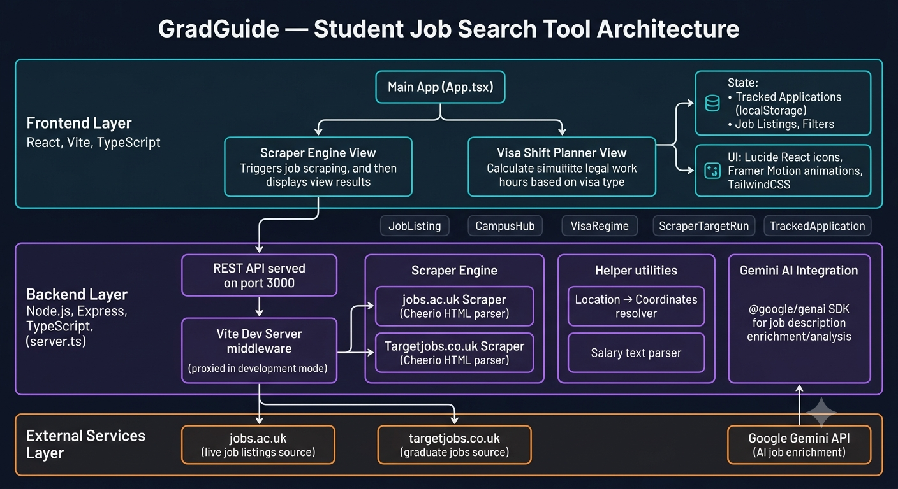

# GradGuide — Documentation Index

> **GradGuide** is a job search tool built specifically for international students. It finds real, live job listings near your university campus, respects your visa work-hour limits, and helps you track applications — all in one place.

---

## Demo Video Link : https://drive.google.com/file/d/1mjudfRJC_jzoQXjm8-InWvXTl4SY-iZ8/view?usp=sharing

## 📚 Documentation

| File | What it covers |
|------|---------------|
| [ARCHITECTURE.md](./ARCHITECTURE.md) | How the system is structured — frontend, backend, and external services |
| [FRONTEND.md](./FRONTEND.md) | The React/Vite UI — screens, components, and state management |
| [BACKEND.md](./BACKEND.md) | The Node.js/Express server, scraper engine, and API routes |
| [SCRAPER.md](./SCRAPER.md) | How live job listings are fetched and parsed from real websites |
| [VISA_PLANNER.md](./VISA_PLANNER.md) | How visa rules and the work-hour planner work |
| [DATA_TYPES.md](./DATA_TYPES.md) | All the data shapes (TypeScript types) used across the app |
| [GEMINI_AI.md](./GEMINI_AI.md) | How Google Gemini AI is used to enrich job descriptions |
| [ARCHITECTURE_AND_WRITEUP.md](./ARCHITECTURE_AND_WRITEUP.md) | Original detailed write-up on scraper design & feature rationale |

---

## 🚀 Quick Start

```bash
# Install dependencies
npm install

# Add your Gemini API key
cp .env.example .env
# Edit .env and fill in GEMINI_API_KEY

# Start the dev server (runs both backend + frontend)
npm run dev
```

The app will be available at **http://localhost:3000**.

---

## 🎯 Who is this for?

GradGuide is built for **international students** who need to:

- Find part-time jobs and internships **near their university campus**
- Stay within their **visa's work-hour limits** (UK, US, Canada, Australia)
- Track where they are in the application process
- Understand whether a job is **on-campus or off-campus** (important for US F-1 visa holders)

---

## 🗺️ Architecture Overview



The system has three layers:

1. **Frontend** — A React app the student uses in their browser
2. **Backend** — A Node.js server that scrapes live job boards
3. **External Services** — The real job websites being scraped + Google Gemini AI

See [ARCHITECTURE.md](./ARCHITECTURE.md) for a full breakdown.
